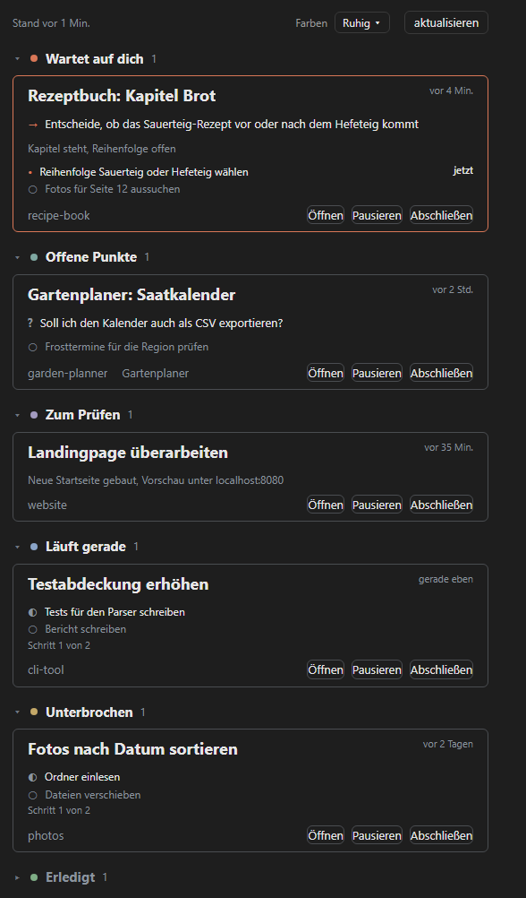

# Claude Session Monitor

A mod for Claude Code that adds a **Sessions** pane to the Claude Code desktop app. It reads your local
sessions and sorts them by what they need from you: which ones wait for a decision, which ones left open
items or a question, which ones are ready for review, still running, or were interrupted.



*Approximate preview rendering with synthetic sample data, not a capture of the app.*

## Features

Every session lands in one bucket:

| Bucket | Meaning |
| --- | --- |
| **Wartet auf dich** | The session needs a decision, approval or action from you. |
| **Offene Punkte** | Reported as finished, but names open items or ends with a question to you. |
| **Zum Prüfen** | A result is ready and wants to be looked at. |
| **Läuft gerade** | A turn is still running, or the session is working in the background. |
| **Unterbrochen** | The turn was cancelled, errored or got stuck, or the task list was left unfinished. |
| **Pausiert** | You paused it in the monitor. |
| **Ohne Status** | The app stored no assessment for this session (usually an old one). |
| **Erledigt** | Finished, nothing left open. |

- Each session is a card with its title, the next thing to do, open items and open task-list steps,
  and the time of its last activity.
- **The whole card is clickable** and opens that chat in the desktop app.
- **Pausieren** / **Abschließen** move a session to *Pausiert* / *Erledigt*. This only happens in the
  monitor: nothing is archived or changed in the app. New activity in the session clears the mark, and
  the session returns to its own bucket.
- **Sub-sessions** show the name of their main session (the root of the parent chain) next to the folder.
- The first buckets are expanded; *Pausiert*, *Ohne Status* and *Erledigt* start collapsed.

## Colour schemes

The pane comes with three colour schemes. Pick one with **Farben** at the top of the pane, next to
**aktualisieren**:

| Scheme | Look |
| --- | --- |
| **Ruhig** (default) | Neutral grey card frames; only *Wartet auf dich* carries the accent (Claude orange). Groups differ by a muted dot; buttons are plain grey outlines. |
| **Ampel** | Colour only where it means urgency: waiting orange-red, open items amber, running blue, done green, everything else grey. Frames are muted; only **Abschließen** is outlined in green. |
| **Flächen** | No coloured frames: each card has a faint fill in its group's tone behind a fine neutral line, with flat grey buttons. |

The choice is saved in the plugin's own store and applies to every session, also ones already open
(they pick it up at their next refresh). In all three, secondary text (folder, time, counts, open items)
uses a readable grey. Colours given as app theme keys (text, greys, the Claude accent) follow the
light and dark theme; the fixed hex accents of *Ampel* and the translucent frames and fills stay the
same and look slightly different on a light or dark background.

## Requirements

- The Claude Code desktop app. Tested on Windows only.
- Node.js 18 or later on your `PATH` (the pane runs `node` to read and classify the sessions).

## Installation

At the prompt of a terminal session:

```
/plugin install session-monitor --marketplace Lutoss/claude-session-monitor
```

Answer `y` to add the marketplace, then pick a scope (user scope is the first choice).

From a shell:

```
claude plugin install session-monitor --marketplace Lutoss/claude-session-monitor
```

In the desktop app, where `/plugin` does not run: click **+** next to the prompt box, then **Plugins**,
**Add marketplace** with `Lutoss/claude-session-monitor`, then **Add plugin**.

A mod installed from a terminal at the user scope also loads in the local sessions the desktop app starts.

## Usage

Type `/sessions` in a session of the desktop app. The pane does not open by itself; `/sessions` opens it
and reloads the data. Nothing runs before you open it for the first time in a session; from then on it
refreshes every 2 minutes until the session ends. The **aktualisieren** button refreshes at once.

## Privacy

- The monitor reads only local files: the desktop app's session metadata
  (`%LOCALAPPDATA%\Claude-Data\*\claude-code-sessions`) and the session transcripts
  (`~/.claude/projects`).
- Nothing leaves your machine. There are no external network requests; the optional web view below
  listens on `127.0.0.1` only and polls its own local `/api/sessions`.
- It writes a cache file in your system's temp folder (`os.tmpdir()`, `session-monitor-cache.json`) and
  the pause/finish marks and the chosen colour scheme in the plugin's own store. The optional web view
  also keeps hidden sessions in the browser's `localStorage`, and `--html <file>` writes the file you
  name.

## Optional web view

The same classification is available as a local web page:

```
node scripts/session-monitor.mjs --port 4317
```

Then open <http://localhost:4317>. Other modes: `--json` prints the classification, `--html out.html`
writes a static page, `--all` includes archived sessions.

## Development

```
claude plugin validate .
claude plugin test .
node tests/session-monitor.test.mjs
```

To try a working copy in the desktop app, add its folder to `CLAUDE_CODE_PLUGIN_DIRS` in the `env` block
of `~/.claude/settings.json`, or start a terminal session with `claude --plugin-dir <folder>`.

Layout: `hooks/register.tsx` (hooks, data, actions), `hooks/pane.tsx` (pane drawing),
`hooks/card.tsx` (clickable card content), `hooks/palettes.ts` (colour schemes),
`scripts/session-monitor.mjs` (classification, web view, opening a session).

## Limitations

- The app's metadata is looked up at the Windows location (`%LOCALAPPDATA%\Claude-Data`). On macOS or
  Linux the pane finds no sessions unless you run the script with `--meta-dir <folder>`; the pane itself
  does not pass one.
- The interface is in German. The detection of open items also looks for German headings in the replies
  (`Noch offen bei dir`, `Offene Punkte`, `Offen`, `Für dich`), and closing questions are recognised by
  German pronouns (du, ich, wir …).
- The classification is heuristic: it combines the app's own status summary with what the transcript
  shows. A session can end up in the wrong bucket.
- Opening a session uses the `claude://` deep link, handed to the system's URL handler
  (`rundll32` on Windows, `open` on macOS, `xdg-open` elsewhere).

## License

[MIT](LICENSE)
